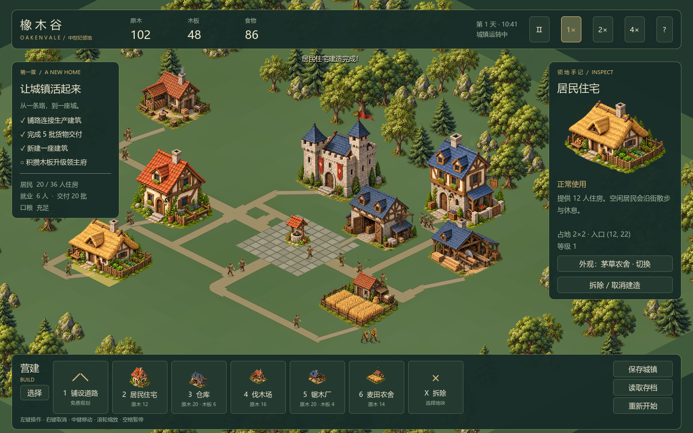

# Medieval Realms · 中世纪领地（暂定名）

欧洲中世纪题材、固定斜视角 2.5D 的单机城镇经营与领土战略游戏。
玩家规划城镇，观察居民生产、搬运和生活，再通过军队探索、出征和扩张。

**当前阶段：城内原型 · 第二轮画面打磨。** 已有三种可切换住宅外观、中心石铺广场、分级泥土街巷、四方向六帧行走和三种职业工作动作。包含建造、施工、生产运输及本地存档。世界地图与军队尚未实现。



## 开始

使用 **Godot 4.7.2 Standard / GDScript** 导入根目录 `project.godot`，按 F5 运行项目。无需 Node、服务器或账号。当前电脑也可双击 `play.bat`；脚本会使用项目上一级目录的 Godot 4.7.2，其他电脑可设置 `GODOT_BIN` 或用编辑器打开。

## 可以玩什么

开局 20 名居民、主堡、主仓库、两座住宅与三种产业。选择居民观察目的地、工作和货物。伐木工运回原木，木匠取 2 原木加工 3 木板，农夫收获食物；每 45 游戏秒消耗 20 食物。初期资源足够继续扩建。

从下方营建栏放置建筑，黄色菱形是入口。材料会预留，居民搬到工地后施工。入口需接通道路；可选中建筑点“接通入口道路”。新住宅增加住房容量；当前人口固定 20 人，人口迁入、市场需求与更复杂生活行为后续加入。

选中住宅可切换红瓦庭院、蓝顶联排、茅草农舍外观，选择会随存档保存。新开局围绕水井广场布局，老存档保留原建筑与道路；需要体验新布局时，可先保存，再选择“重新开始”。

积攒 40 木板可选中领主府升级至 2 级。第二座仓库目前是可建造的扩展建筑，生产运输仍使用初始主仓库。

操作：左键选择/放置；按住左键铺路；右键/Esc 取消；中键拖拽或 WASD 平移；滚轮缩放；Home 镜头归位；G 网格；空格暂停；1～6 建造工具；X 拆除；Ctrl+S 保存、Ctrl+L 读取。

存档在 Godot `user://saves/city.json`，保存时保留 `.bak`。默认不自动覆盖存档，离开前请点“保存城镇”。

Windows 命令行（路径含空格请加引号）：

```powershell
./scripts/check.ps1 -GodotPath '你的 Godot 控制台程序完整路径'
```

检查包含编辑器导入、时钟/投影、经济/运输/施工、存档兼容、实际场景交互、动画区域/脚底基点及暂停表现检查。GitHub Actions 使用相同引擎版本执行检查。

## 项目入口

- [产品设计与首版范围](DEV_SPEC.md)
- [画面方向与官方参考图](docs/ART_DIRECTION.md)
- [架构与数据流](docs/ARCHITECTURE.md)
- [旧项目迁移清单](docs/MIGRATION.md)
- [开发顺序与验收条件](docs/ROADMAP.md)
- [验证记录与原型边界](docs/VALIDATION.md)
- [美术资产登记](assets/README.md)
- [协作约定](AGENTS.md)

目录：`scenes/` 场景、`src/core/` 基础逻辑、`src/city/` 城镇模拟与定义、`src/presentation/` 表现与交互、`assets/generated/` 生成素材、`tests/` 逻辑与场景检查、`docs/` 设计、`scripts/` 启动/检查脚本。

本项目从 `E:\slg1.0` 的玩法经验重新设计，旧网页项目保持独立。未复制旧存档、账号或部署配置。暂未授予开源许可；第三方图片仅作为参考链接，不是游戏资源。
