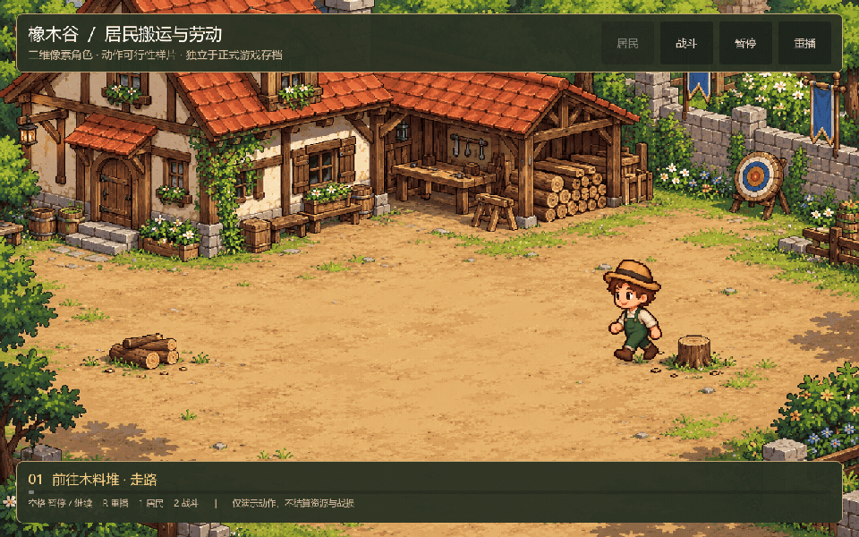
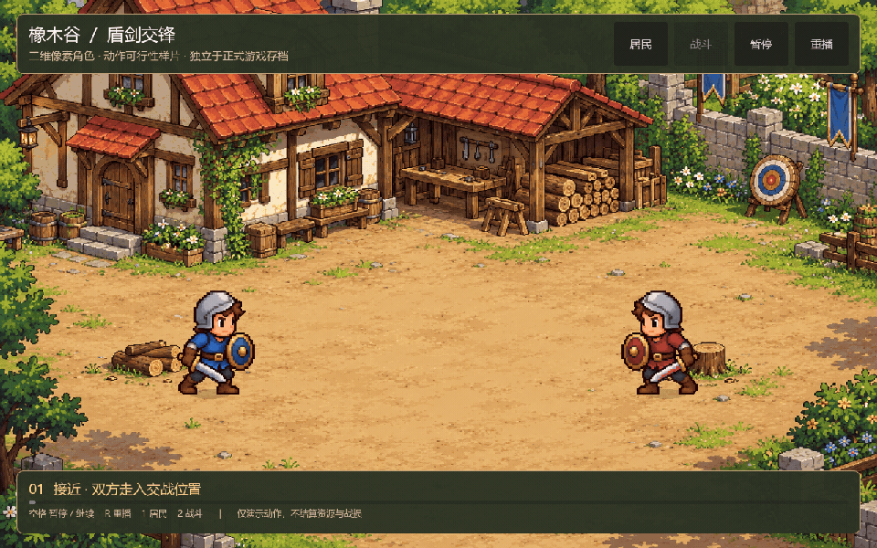

# A 方向美术与二维资源管线 · 独立调研交接

日期：2026-10-19  
项目：Medieval Realms／橡木谷，欧洲中世纪单机城堡经营与战略游戏  
用途：供新对话独立调研、比较方案并与用户确认；本文不是已经批准的量产规格。

## 1. 新对话先读这一节

用户认可最近制作的二维居民、战斗动画的整体风格，希望以 **A：像素田园／二维手绘卡通** 为后续调研方向。需要解决的是：如何持续生产数量较多、风格统一、动作可靠的居民、建筑、兵种、装备与特效，而不是继续生成几张漂亮概念图。

已有二维样片可用于判断审美倾向，尚不能证明多方向、换装、骑兵、模块城建和大规模战斗的管线已经成立。用户希望在另一个对话调研和确认，避免之前探索过程影响判断。

请优先依据本文和实际样片理解需求。仓库旧文档中“已采用微缩立体感”等内容记录的是此前原型，不应当作当前必须延续的美术决定。本文也不授权直接替换正式游戏全部资源。

## 2. 已明确的项目需求

- 离线单机；不需要游戏账号、后端或联网系统。制作阶段使用在线生成工具与游戏运行时联网是两回事。
- 欧洲中世纪题材，固定斜俯／等距的 2.5D 观感；二维图片也可以承载这种空间表现，尚未要求自由旋转镜头。
- 城内能自主建造城池，看到居民工作、搬运、生活；之后连接军队出征、世界地图与可能的战斗场景。
- 居民、建筑、兵种和特效种类会比较多，应按长期扩充评估，不以两三个人的小样成本代表全项目成本。
- 生活感参考星露谷、开罗；城市规划与生产观察参考纪元等；世界战略参考文明／P 社。参考分工不等于照搬画面或功能。
- 用户认为此前画面过于写实，倾向亲切、卡通、大头短身、易读的表现。
- 用户否定了基础几何体拼装的三维样片。程序能运行、动作能摆动，不代表建模或美术质量合格。

## 3. A 的画面方向

### 3.1 从认可样片提炼的候选特征

用户认可的是样片整体风格，未逐项确认下列配色和细节。除第 2 节已明确需求外，这些作为调研输入，仍可提出调整，不作为锁死的美术规范。

- 整体为温暖的中世纪田园城堡：红／橙瓦、奶油色墙面、棕色木梁、柔和绿植、土路与简洁石铺地面。
- 居民和士兵大头短身，面部能辨认；通过轮廓、服装、工具和武器区分职业与兵种。
- 清晰的色块、受控的阴影和有设计的轮廓；避免写实石材、木纹、皮肤和密集材质噪声。
- 动画可以是有限帧数，重点是关键姿势、节奏、重心、工具接触和命中反馈，不把“每个动作都丝滑”作为首要目标。
- 建筑、人物、道路、植被、特效和界面需要共享视觉规范；不要只把人物变可爱、其余仍保留写实质感。
- 远景看得清街区、建筑功能、兵种和战况，近景能欣赏居民劳动与生活。

### 3.2 尚未锁定的规格

以下都需要调研与样片验证，不能直接写成用户已确认参数：

- 严格低分辨率像素画，还是高分辨率的像素感／手绘卡通。
- 逻辑像素尺寸、统一像素密度、整数缩放和镜头缩放规则。
- 人物具体头身比、轮廓线粗细、调色板与光照方向。
- 四方向还是八方向；哪些动作允许镜像；装备左右手如何处理。
- 每类动作的帧数、帧时长、循环方式，以及脚底、工具、受击锚点。
- 换装采用完整人物帧、分层精灵、二维骨骼，还是混合方式。
- 是否允许部分资产借助三维工具辅助制作；不得把重新全面走三维路线当成默认结论。

**重要区别：当前样片具有像素／手绘卡通观感，但源图是高分辨率生成图片，未建立严格统一的逻辑像素网格。它不是已经合格的低分辨率像素量产范例。**

## 4. 已有样片与工程入口

项目根目录：`E:\GodotChat`。Godot 基线：4.7.2 Standard／GDScript。正式原型仍为二维等距城镇；新样片为独立场景，不读取或修改正式存档。

当前交接所在分支：`feat/2d-animation-proof`。二维样片代码提交：`6eb2008`。仓库为公开仓库；[样片草稿 PR #4](https://github.com/kennysli1/medieval-realms/pull/4)。截至本文记录，PR 尚未合并，不能假设主分支已有这些文件。调研前先检查实际分支和工作区，不覆盖现有修改。

`6eb2008` 包含样片代码、素材与预览，不包含随后新增的本文。需要锁定交接文档版本时，用 `git log -1 -- docs/ART_A_PIPELINE_RESEARCH_HANDOFF.md` 查看其实际提交，或在 PR #4 的文件列表找到本文。

### 4.1 先看实际动画

居民：12 秒循环，走路 → 搬木 → 挥斧劳动 → 停留。

- [居民 MP4](previews/resident-2d.mp4)
- [居民启动脚本](../watch-resident-2d.bat)
- [居民 Godot 场景](../scenes/pixel-proof/resident.tscn)

战斗：10 秒循环，接近 → 蓝方攻击／红方格挡受击 → 红方反击 → 交锋 → 拉开距离。

- [战斗 MP4](previews/battle-2d.mp4)
- [战斗启动脚本](../watch-battle-2d.bat)
- [战斗 Godot 场景](../scenes/pixel-proof/battle.tscn)

启动后可用空格暂停、R 重播、1／2 切换。录制按每秒 20 帧固定推进；GIF 重采样为 15 fps，保持原播放速度，居民／战斗时长仍分别约为 12／10 秒，MP4 仍为 20 fps。这些不是正式动画帧率或游戏性能目标。

### 4.2 素材与实现索引

- [素材说明](../assets/generated/pixel-proof/README.md)：哪些帧被采用、已知问题及复现方法。
- [生成提示词与来源](../assets/generated/pixel-proof/manifest.json)。
- [居民第二版提示词](../assets/generated/pixel-proof/resident-spaced-prompt.txt)。
- [原居民图](../assets/generated/pixel-proof/resident.png)：六列三行，仅采用第一行走路。
- [留白更充分的居民图](../assets/generated/pixel-proof/resident-spaced.png)：采用搬木与挥斧两行。
- [士兵图](../assets/generated/pixel-proof/knight.png)：四列三行，走路、攻击、格挡／受击。
- [院落背景](../assets/generated/pixel-proof/yard.png)：固定完整插画，未拆分可建造资产。
- [帧区域和鞋底锚点](../assets/generated/pixel-proof/frames.json)。
- [区域测量工具](../tools/measure_pixel_proof.gd)：按透明连通轮廓寻找完整人物，保留武器，测量鞋底锚点；不重写原 PNG。
- [角色采样](../src/pixel_proof/actor.gd)、[换色与透明阈值 shader](../src/pixel_proof/actor.gdshader)。
- [编排、界面、特效和录制](../src/pixel_proof/demo.gd)。
- [GIF／MP4 编码脚本](../scripts/encode-2d-previews.ps1)、[18 项样片检查](../tests/run_pixel_proof_tests.gd)。

## 5. 已验证的内容与不能外推的内容

### 5.1 已做成的有限验证

- 原创二维图片可以在 Godot 中采样为角色动画；角色不需要三维模型才能走路、搬运和交锋。
- 本次二维样片的整体风格获得用户正面反馈。
- 几个不同姿势与位移、动作时序、换色及简单特效组合，可以表达劳动和盾剑交锋。
- 等分图集可能截断武器；透明轮廓测量和落脚锚点有助于资源接入。
- 红方采用运行时衣服／盾牌换色，本次不需要另生成整套红方动作。
- 本地基础检查、61 项城镇、31 项界面、18 项二维样片检查通过；GIF／MP4 来自真实 Godot 场景录制。测试结果不代替美术验收。

### 5.2 尚未验证／当前限制

- 帧间体积、姿势、步态和道具位置仍有差异；尚非逐帧精修完成的成品动画。
- 仅少量角色、单个主要朝向加镜像，不代表四／八方向一致性已经解决。
- 当前只是移动和交锋编排，没有真实采集库存、寻路、战斗决策或伤害结算。
- 衣服／盾牌换色成功，不代表发型、服饰、盔甲和武器可以任意分层换装。
- 自动透明连通区域测量不能保证所有资产都能正确拆分；分离的武器、拖尾、粒子或相邻帧粘连都可能失败。
- 未验证骑乘、长武器、弓弦、投射物、死亡、坐下、进屋等更困难动作。
- 固定背景尚未解决建筑模块、道路连接、入口、遮挡、施工阶段与自由布局。
- 没有用这些样片证明大规模单位性能或全项目生产成本。
- 没有完整 token、图像生成账单、返工时间和人工修正记录，不能声称比 Blender 固定便宜某个比例。

## 6. 后续管线的重点调研方向

### 6.1 先确定可执行的美术规范

比较严格像素与像素感手绘两条路线，分别列出画质、一致性、缩放、修图、工具和动画成本。用同一角色与同一动作对照，不只比较静态宣传图。

提出人物、建筑、地块、植被、装备、特效的统一规格。人物 48×64、64×64 或 64×96 等可以作为测试候选，不是已确定尺寸。现有地格 128×64 是旧原型投影参数，不能直接推出所有新素材的分辨率。

### 6.2 AIGC 如何得到可修、可复现的动作

调研角色标准图／母版、参考图编辑、姿势约束、逐帧生成、整张图集生成、视频转序列等方式。对每种方式检查身份保持、帧间体积、动作完整性、透明背景、留白与可控性。

明确哪些步骤可自动化，哪些必须由美术修整。不能假设“AI 能画一张角色图”就等于能稳定生成方向、换装与连续动画。视频输出还要评估视角漂移、闪烁、帧抽取和可编辑性。

### 6.3 少帧序列、分层精灵与二维骨骼的取舍

分别研究完整逐帧、身体／头发／衣服／装备分层、二维骨骼与混合方案。研究像素轮廓经过旋转、缩放或变形后是否仍成立，避免把僵硬摆动或像素破坏当成复用成功。

换装要明确遮挡顺序、手部锚点、握持姿势、左右手、镜像规则和不同朝向的层级。对骑兵、弓兵与长武器单独评估，不把普通走路的结果外推到所有兵种。

### 6.4 建筑与路网的二维模块化

研究整体建筑图、基础墙体／屋顶模块、门窗装饰、等级配件、施工叠层与受损状态之间的取舍。保证透视、光照、占地和门口位置统一。

将院落插画仅作为气氛参考。正式城建应验证独立资产的透明边缘、地面拼接、道路转角和交叉口、可见门口与逻辑入口、建筑前后遮挡，不能把整张背景当成城建系统。

### 6.5 特效与动作事件的连接

研究少帧尘土、木屑、烟火、箭矢和命中效果的制作方式，以及统一像素密度、锚点、发射方向和图层。

动作中应有明确的接触／发射／命中时刻。考虑落脚、握持、挥击弧线、武器尖端与目标位置，避免“动作在一边播，特效在另一边出现”。正式资源变化仍由模拟层决定，表现层只响应状态和事件。

### 6.6 工具与授权

调查可用的图像生成／编辑工具、像素编辑器、二维动画与图集工具、Godot 导入流程。Aseprite、LibreSprite、Krita 等只作为候选名称，需要重新核实当前功能、版本、授权、自动化接口和费用，不视为采购推荐。

每个候选记录：能实际调用的方式、是否支持批量／参考编辑、人工修正工作量、商业用途与再分发条件、数据保存、来源追溯。游戏资产应可离线随包使用。开罗等参考游戏的截图只能分析，不能当成正式资源。

### 6.7 成本：按合格资产核算

分开记录文本 token、图像生成费用／额度、工具调用数、总耗时、返工次数、人工修图和失败原因；不要把不同模型的 token 当作同一单位直接相加。

用“合格动作集／合格资产”的总成本衡量，区分首次建立角色母版与新增衣服、职业、动作、方向的边际成本。比较时保持画质、朝向、动作和交付规格一致，不拿概念图与可上线资源比价。

数量估算需列出身体类型、动作、朝向、服装、装备和特例，并说明哪些组合真实复用，哪些仍需补画。避免简单认为分层后所有组合都免费，也避免把组合数直接当成必须重画的图片数。

### 6.8 引擎接入与规模验证

研究帧清单、稳定资源 ID、锚点、方向映射、帧时长、循环与一次性动作、事件点、命中区域、版本与导入校验。原始图、精修源文件、导出图集、元数据和生成记录应可追溯。

评估图集与显存、同屏渲染、透明过绘、分层绘制量、动画更新与模拟／寻路开销。可以提出不同单位数量的测试档位，但同屏目标与最低硬件尚未确定，需要确认。两人动画流畅不代表整城／战场性能已验证。

## 7. 建议的小样验收顺序（待确认）

1. 一套角色母版：统一正面／侧背方向、比例、色板和装备尺寸。
2. 一个居民：完整走路、搬运、劳动闭环，检查实际尺寸与放大画面。
3. 一个步兵：走路、攻击、格挡／受击；加入一个不同武器或服饰验证复用是否真实成立。
4. 一个困难类型：弓兵或骑兵，验证道具与身体的接触、遮挡和多方向。
5. 一组可建造资产：住宅、工坊、树木和道路，验证入口、拼接与遮挡。
6. 同一批资产做城内与战斗密度测试，再决定是否量产。

视觉验收检查身份、体积、像素密度、轮廓、脚底漂移、循环跳帧、道具握持、命中时机、方向与换装遮挡。技术验收检查透明边缘、裁切、锚点、重现性、存档兼容和性能。两者应分别报告。

## 8. 新对话应交付的结果

- 推荐路线与至少一个备选，说明适用条件和失败风险，不只罗列工具。
- 建议的美术规格、资源分类、动作／方向最小集合和可复用部分。
- 从角色母版到生成、修整、动画、导出、Godot 接入与验收的完整管线。
- 最小验证包、验证方法、可确认与仍不确定的事项。
- 有来源的工具／许可结论，以及按合格资产计算的成本记录或估算依据；缺少数据时明确标注。
- 明确列出需要用户确认的选择，再进入批量资产生产或全面重构。

调研期间可以读源码、检查样片和进行必要的只读工具核实。不要默认安装收费工具、购买素材、生成大批资源、替换正式项目或迁移引擎表现层。需要实验时先提出有限范围，并区分实验结果与尚未验证的推断。

## 9. 可直接粘贴到新对话的开场指令

> 请读取 `E:\GodotChat\docs\ART_A_PIPELINE_RESEARCH_HANDOFF.md`，这是本次独立调研的上下文入口。先看文中的居民和战斗 GIF／MP4 以及素材原图，再评估 A 方向：欧洲中世纪、像素田园／二维手绘卡通、大头短身，承载较多居民、建筑、兵种、装备、特效和城堡战斗。
>
> 用户认可最近二维样片的整体风格，但尚未确定严格像素还是像素感手绘、具体尺寸、方向数、帧数、工具与量产管线。请独立调研 AIGC 生成与修整、逐帧／分层／二维骨骼复用、建筑模块化、特效、Godot 接入、许可和实际成本，提出一条推荐路线与备选。引用当前官方资料，区分已验证事实、工程判断和待测试假设。
>
> 这次先完成调研与方案确认，不直接批量生产资源或重构正式游戏。不要把之前三维路线的建议当成既定结论，也不要在没有成本记录时宣称二维固定节省多少 token。若当前分支找不到文件，检查 `feat/2d-animation-proof` 和草稿 PR #4；不要覆盖工作区修改。无需阅读之前的长对话。

## 10. 后续调研的资料起点

以下为本次交接已知入口；功能、版本、价格与授权需由新对话重新核实。没有在本文中伪装成已完成的新调研结论。

- [Godot 二维序列帧动画](https://docs.godotengine.org/en/stable/tutorials/2d/2d_sprite_animation.html)
- [Godot 分件动画](https://docs.godotengine.org/en/stable/tutorials/animation/cutout_animation.html)
- [星露谷官方画面](https://www.stardewvalley.net/media/)
- [开罗《冒险村物语 2》官方商店画面](https://store.steampowered.com/app/1983710/Dungeon_Village_2/)

没有获取开罗内部源码或制作规范；不能把适合本项目的技术方案写成开罗实际采用的内部实现。
