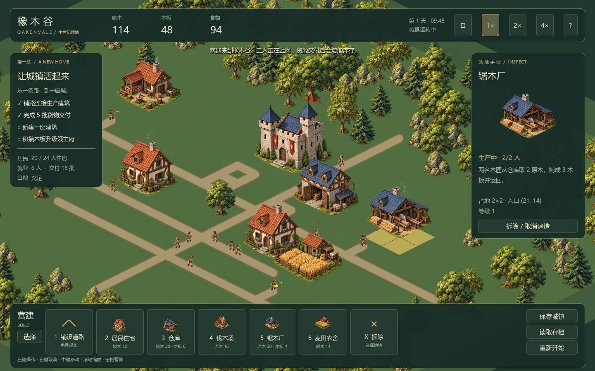

# 画面研究与美术基线

调研：2026-10-16。以下是对官方参考的设计判断；参考作品不代表本项目已拥有同等资产或预算。

## 推荐：温暖、清楚、可观察的中世纪微缩城镇

主方向采用 Foundation / Pioneers of Pagonia 的亲近感，结合纪元的街区与工坊细节。推荐中等细节的手绘/预渲染等距建筑，居民略夸张以便辨认动作。避免过细纹理淹没人物。

推荐色彩：奶油灰石墙、深木梁、赭红/灰蓝屋顶、低饱和草地；交互用少量黄铜色。左上方统一日光，柔和接触阴影。UI 用清楚的图标和克制的羊皮纸/深木色，保持城市主体面积。

## A · Foundation：柔和中世纪聚落（优先参考）

借鉴建筑轮廓、绿地与街区的疏密关系、城堡作为地标的层级。其自由布局不直接照搬；首版仍使用逻辑网格，以控制寻路与建造复杂度。

[官方介绍与图库](https://www.polymorph.games/en/)

## B · Pioneers of Pagonia：忙碌的小人和生产空间（优先参考）

借鉴可观察的搬运、工坊院落和人物动作识别度。实施重点是货物从哪来、工人为什么走这条路、停工原因能否看懂。

[官方截图、视频与 Press Kit](https://www.pioneersofpagonia.com/press.php)

## C · Anno：细腻城市与生产街区（细节上限）

借鉴住宅、市场、道路和产业区的组合，以及缩放观察城市的乐趣。1800 的工业时代美术不照搬，中世纪建筑另做设计。更高细节会放大建筑、地形与动画制作成本，适合作为长期方向。

[Anno 1800 官方画面与介绍](https://www.ubisoft.com/en-au/game/anno/1800)

## D · Kingdoms and Castles：简洁微缩模型（成本备选）

借鉴城墙、塔楼和建筑体量的清晰区分。可读性强、素材制作容易统一，但过度简化会削弱你希望看到的生活细节。建议取轮廓，不整套采用极简外观。

[官方画面入口](https://www.kingdomsandcastles.com/)

## E · 星露谷/开罗式像素表现（备选，不作默认）

优势是人物动作醒目、生活感直观；但与你选择的纪元式斜视城镇相比，比例、视角和材质方向不同。不要将像素居民直接混进写实建筑。

[Stardew Valley 官方媒体](https://www.stardewvalley.net/media/)

## 已采用的原型风格

用户已选择推荐方向：柔和手绘感与预渲染立体感结合的欧洲中世纪微缩城镇。本轮直接生成并接入六种建筑、四方向居民动作与四种自然物，不再等待三种试片确认。

地面格为 128×64 逻辑像素。首轮人物采用四方向、每方向四帧透明图集，携带物与工作工具由程序叠加；八方向及独立负重/职业动作后续补齐。建筑通过 3×2 图集采样。自然物图集生成的两行高度不一致，已按实际边界分别采样，避免截断和相邻物件残片。

生成方式：内置 image_gen；完整提示词与来源记录见 `assets/generated/manifest.json`。

建筑先完成蓝图、施工、完成、升级四阶段表达；人物具备待机、走路、携带、工作；工坊特效包括木屑/烟、农田生长和施工尘土。单位数量增多后仍能辨认，优先于特效密度。

## 来源与许可

截图仅为外链参考，不存入可发布游戏资源。正式资源逐项记录作者、来源、许可、修改和用途，见 assets/README.md。统一风格后再采购或生产资产。
